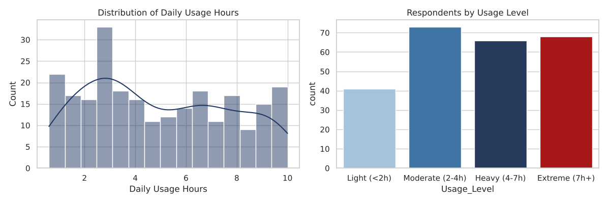
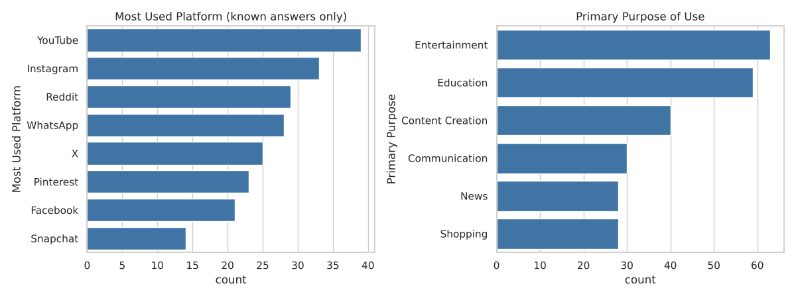
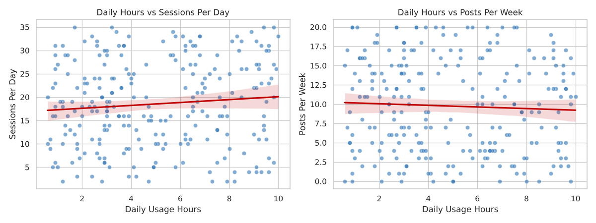
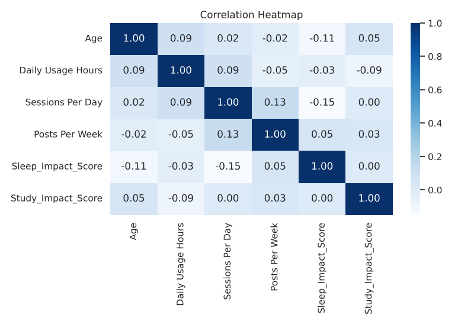
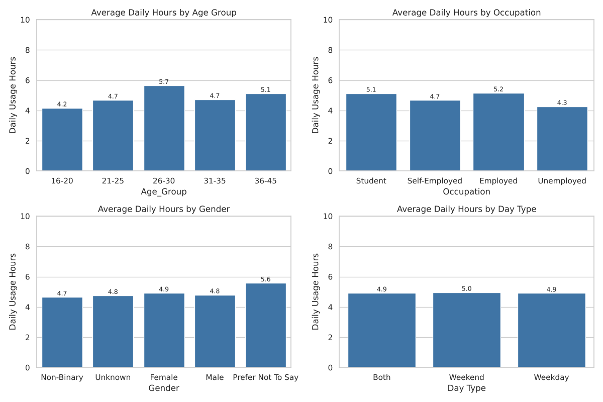
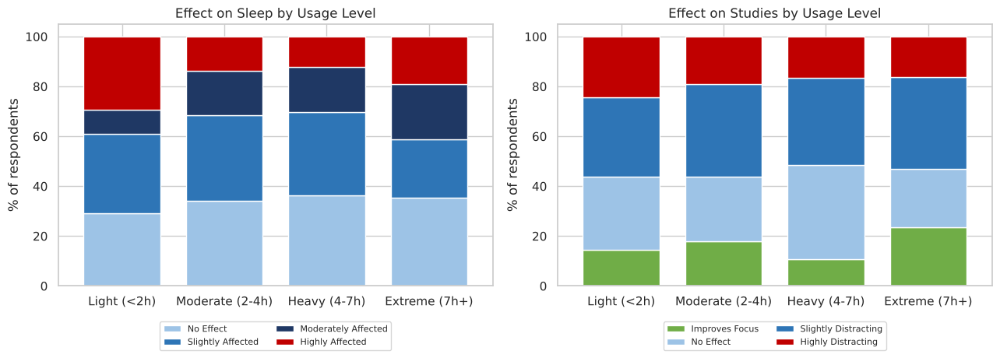

# Social Media Usage Analysis (Data Analyst Project)

A data analysis project that studies **how people use social media** and **how usage relates to sleep and studies**, using Python, pandas, matplotlib and seaborn.

**Author:** Ishant Jaiswal  |  **Admission No.:** 2026B01011006

## Business problem
A digital-wellbeing team wants to understand social media usage patterns and find which users are at risk of heavy usage, so awareness campaigns can target the right groups.

## Questions answered
1. What is the overall social media usage pattern of the respondents?
2. Which platforms and purposes are most common?
3. Do usage hours, sessions and posts move together?
4. Does usage differ by age group, occupation, gender or day type?
5. How does heavy usage affect sleep and studies, and who is at high risk (7+ hours a day with strong sleep or study impact)?

## Dataset
`data/raw/Raw_Social_Media_Usage_Dataset.xlsx` – 250 rows, 16 columns (Participant ID, Age, Gender, Occupation, Most Used Platform, Primary Purpose, Day Type, Daily Usage Hours, Sessions Per Day, Preferred Usage Time, Notifications Setting, Private Account, Posts Per Week, Effect on Sleep, Effect on Studies, Data Usage).

The raw file has data-quality problems that are fixed in the notebook:
- numbers stored as text (`36 years`, `1.7 hrs`, `13 sessions`, `6 posts`)
- inconsistent text (extra spaces, mixed case such as ` female `, `YOUTUBE`)
- the same value written two ways (`On`/`Enabled`, `Off`/`Disabled`, `Yes`/`Private`, `No`/`Public`)
- missing values in Gender, Most Used Platform, Sessions Per Day and Posts Per Week
- 2 exact duplicate rows (some Participant IDs repeat for different people, so only exact duplicates are removed)

Result: **248 clean rows**.

## Project structure
```
social-media-usage-analysis/
├── data/
│   ├── raw/Raw_Social_Media_Usage_Dataset.xlsx
│   └── processed/
│       ├── social_media_usage_clean.csv            (output of the notebook, with new columns)
│       └── Cleaned_Social_Media_Usage_Dataset.xlsx (manually cleaned version, for reference)
├── notebooks/social_media_usage_analysis.ipynb
├── images/                  (charts saved by the notebook)
├── requirements.txt
├── .gitignore
└── README.md
```

## How to run
```bash
git clone https://github.com/<ishant382>/social-media-usage-analysis.git
cd social-media-usage-analysis
pip install -r requirements.txt
jupyter notebook notebooks/social_media_usage_analysis.ipynb
```

## Steps followed
1. Load and inspect data  2. Clean data (spaces, text-numbers, labels, missing values, duplicates)  3. Create new columns (Usage_Level, Age_Group, Sleep_Impact_Score, Study_Impact_Score, High_Risk)  4. Exploratory analysis with charts  5. Insights and recommendations

## Key findings (from this dataset)
- Average use is about **4.9 hours a day** (median 4.5); **54%** of respondents use social media 4+ hours daily.
- **YouTube** is the most used platform and **Entertainment** is the most common purpose.
- Highest average usage is in the **26-30** age group (5.7 h) and among **employed** respondents (5.2 h); the lowest is the **16-20** group (4.2 h).
- Weekday, weekend and "both" users spend almost the same time online (about 4.9-5.0 h).
- Daily hours show **almost no linear relationship** with sessions per day, posts per week, or self-reported effect on sleep and studies (all correlations below 0.1).
- **35 respondents (14%)** are flagged High Risk: 7+ hours a day with a strong effect on sleep or studies.

> Correlation does not prove causation, and effects on sleep and studies are self-reported.

## Charts







## Tools
Python 3 · pandas · NumPy · matplotlib · seaborn · openpyxl · Jupyter Notebook · Git and GitHub

## Author
**Ishant Jaiswal** – Admission No. 2026B01011006
